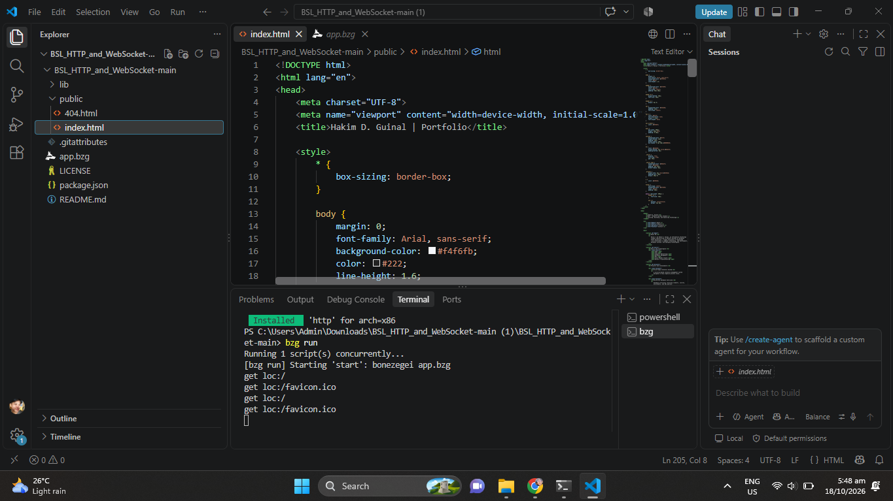
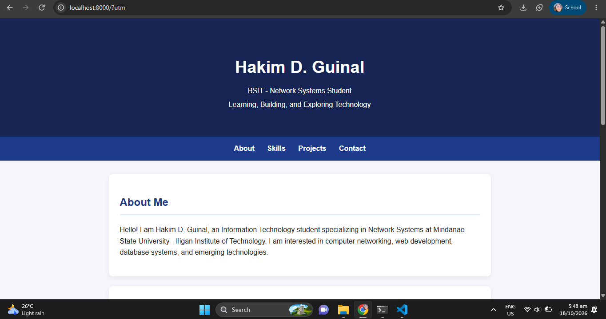

# Personal Portfolio Landing Page

## 1. Project Description

This project is a personal portfolio landing page developed for CCC181: Application Development and Emerging Technologies.

The webpage introduces me, lists my skills and technologies, presents my projects, and provides my contact information.

### Technologies Used
- HTML
- CSS
- Bonezegei Scripting Language (BSL) v1.3.3
- Visual Studio Code
- GitHub

## 2. Setup and Execution Steps

### Prerequisites
- Bonezegei Scripting Language v1.3.3
- Visual Studio Code
- Bonezegei Scripting Language Formatter extension

### Installation
1. Download or clone the project repository.
2. Open the project folder in Visual Studio Code.
3. Open the integrated terminal in the project directory.
4. Install the project dependencies:

```bash
bzg install
```

### Running the Application
1. Open the integrated terminal.
2. Run the application:

```bash
bzg run
```

3. Wait for the server to start.
4. Open the local server address in a web browser.
5. Verify that the portfolio page displays correctly.

## 3. Execution Verification

### Terminal Screenshot



### Browser Screenshot



## 4. Project Structure

- `app.bzg`: BSL application script.
- `package.json`: Project dependency configuration.
- `public/index.html`: Personal portfolio webpage.
- `README.md`: Project documentation.
- `LICENSE`: Project license.
